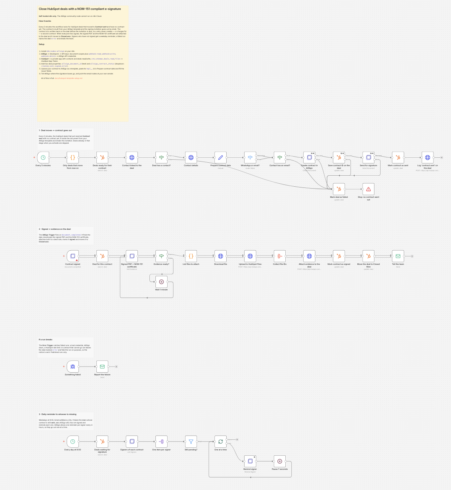

# Close HubSpot deals with NOM-151 compliant e-signature, by email or WhatsApp

> **Self-hosted n8n only.** This template uses the AllSign community node
> (`n8n-nodes-allsign`), and community nodes cannot run on n8n Cloud.

## Who's it for

Sales and operations teams that close deals in HubSpot and need a signed
contract with legal weight in Mexico. AllSign signatures carry a NOM-151
timestamp, so the signed file stands on its own as evidence.

## How it works

Every 5 minutes the workflow looks for deals that moved to *Contract sent* and
have no contract yet. For each one it reads the deal and its primary contact,
builds the contract from an AllSign template, and sends the signing invitation
by email, or by WhatsApp when the contact has a mobile number.

The contract id is written back on the deal before the invitation goes out, so a
retry never creates or charges a second contract: the idempotency key is derived
from the deal, not from the run. If a step fails, the deal is marked with the
error and the team gets an email.

When every signer has signed, the workflow attaches the signed PDF and the
NOM-151 certificate to the deal and moves it to *Closed won*. Signers who have
not signed get a reminder.

## Requirements

- Self-hosted n8n with `n8n-nodes-allsign` installed.
- An AllSign account and API key.
- A contract uploaded to AllSign as a template, with its variables.
- A HubSpot private app token.
- An SMTP account for the failure notices.

## How to set up

The sticky note top-left has the six steps: install the node, add the two
credentials, create two deal properties in HubSpot, upload your contract as an
AllSign template and paste its id, fill in the issuer fields, and tell AllSign
where the signature boxes go.

The last two steps need a little more than a sticky note holds — which issuer
fields AllSign will not accept empty, and the request that places the signature
boxes — so they are written out in
[docs/hubspot-template-setup.md](https://github.com/AllSign-io/n8n-nodes-allsign/blob/main/docs/hubspot-template-setup.md).
The repository also ships a Spanish NDA
(`examples/NDA_Plantilla_AllSign_ES.docx`) you can use as the contract.

## How to customize

Change the deal stages it watches, add signers, switch the delivery channel, or
turn on extra validations such as biometric selfie or ID scan.
