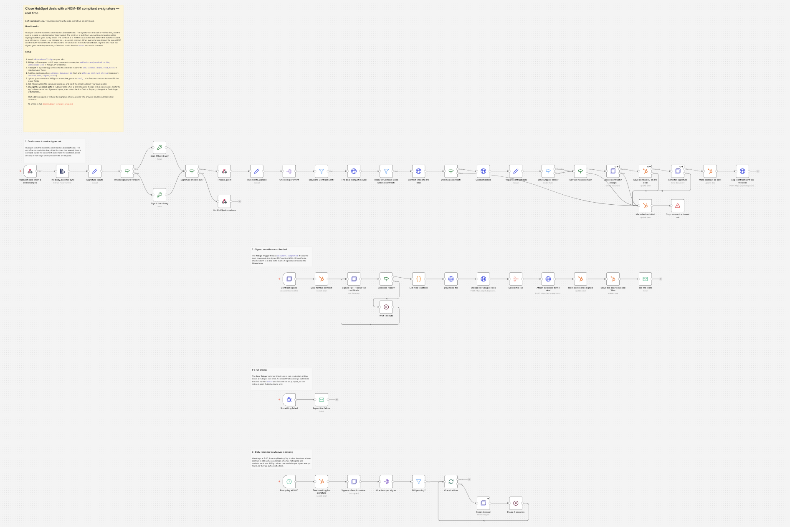

# Close HubSpot deals with NOM-151 compliant e-signature in real time

> **Self-hosted n8n only.** This template uses the AllSign community node
> (`n8n-nodes-allsign`), and community nodes cannot run on n8n Cloud.

## Who's it for

The same job as the every-5-minutes version, for teams that want the contract to
go out the moment the deal moves, not on the next poll. Pick this one if your
HubSpot plan lets you create webhook subscriptions in a private app.

## How it works

HubSpot calls the workflow when a deal changes stage. Before anything else the
workflow verifies HubSpot's signature against your app's client secret: a call
with a bad or missing signature is answered `401` and goes no further. A valid
call gets its `200` right away, so HubSpot never waits on the contract being
built.

From there it is the same path: read the deal and its contact, build the
contract from an AllSign template, and send the invitation by email or WhatsApp.
The contract id is written back on the deal first, and the idempotency key comes
from the deal, so a replayed webhook cannot create or charge a second contract.
Failures mark the deal and email the team.

When everyone has signed, the signed PDF and the NOM-151 certificate are
attached to the deal and it moves to *Closed won*.

## Requirements

- Self-hosted n8n with `n8n-nodes-allsign` installed, reachable over HTTPS.
- An AllSign account and API key.
- A contract uploaded to AllSign as a template, with its variables.
- A HubSpot private app with a webhook subscription and its client secret.
- An SMTP account for the failure notices.

## How to set up

Follow the sticky notes: create the deal properties, upload your contract as an
AllSign template, tell AllSign where the signature boxes go, paste your public
webhook URL and your HubSpot client secret, and subscribe the private app to the
deal stage change.

## How to customize

Change the stages it reacts to, add signers, switch the delivery channel, or
turn on extra signature validations.
