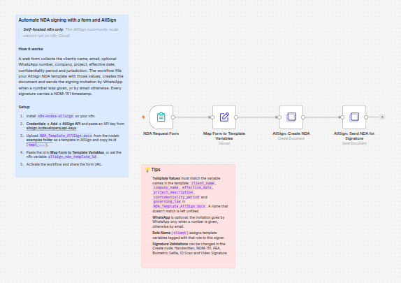

# Automate NDA signing with a form and AllSign

> **Self-hosted n8n only.** This template uses the AllSign community node
> (`n8n-nodes-allsign`), and community nodes cannot run on n8n Cloud.

## Who's it for

Legal, sales and operations teams that send the same NDA over and over and want
the other party to sign it from their phone, with legal weight in Mexico. AllSign
signatures carry a NOM-151 timestamp, so the signed file stands on its own as
evidence.

## How it works

A web form collects the client's name, email, optional WhatsApp number, company,
project, effective date, confidentiality period and jurisdiction. The workflow
fills your AllSign NDA template with those values and creates the document. A
second AllSign node sends the signing invitation by WhatsApp when a number was
given, or by email otherwise.

## Requirements

- Self-hosted n8n with `n8n-nodes-allsign` installed.
- An AllSign account and API key.
- The NDA uploaded to AllSign as a template. The repository ships one in English,
  `examples/NDA_Template_AllSign.docx`, with its variables already in place.

## How to set up

The sticky note on the left has the five steps: install the node, add the AllSign
credential, upload the NDA as an AllSign template, paste its id in **Map Form to
Template Variables** (or set the n8n variable `allsign_nda_template_id`), and
activate the workflow to get the form URL.

## How to customize

Add form fields and template variables, add a second signer for your own company,
or turn on extra validations in the Create node such as biometric selfie, ID scan
or video signature.
